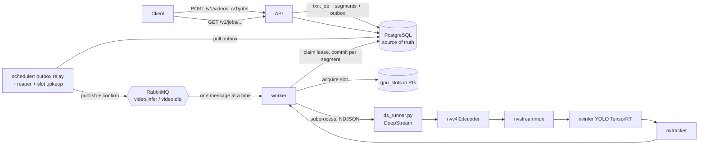

# Architecture (Phase 1-3)

Goal: `Video Upload -> RabbitMQ -> GPU Scheduler -> DeepStream + YOLO -> PostgreSQL -> Result API`
on a **single shared GPU** (DGX Spark GB10, no MIG), without disturbing the existing vLLM
processes. Design rule: the simplest thing that meets the requirement; one modular monolith
package, two small long-running services plus the API, no extra frameworks.



## Components

| Component | Responsibility | Must not |
|---|---|---|
| `services/api` | Upload/register videos (ffprobe validation), create jobs, serve results | run inference, talk to RabbitMQ |
| `shared/database` | All SQL: jobs/lease logic, atomic segment commit, outbox, GPU slots | contain business rules beyond persistence |
| `services/scheduler` | Outbox relay (to RabbitMQ with confirms), lease **reaper**, GPU slot table upkeep | process video |
| `services/worker` | Consume a job, run its segments, record outcome, ack after commit | decide retry policy outside `handler.py` |
| `services/event_processor` | **Pure** functions: detections -> tracks -> events | do I/O |
| `deepstream/app/ds_runner.py` | One DeepStream pipeline for one window; NDJSON out | touch the database or queue |
| `shared/domain` | Backoff, segment planning, state machine, error taxonomy | import infrastructure |

The worker talks to DeepStream through a **subprocess** (not in-process): a GStreamer/CUDA crash
cannot kill the worker, a hung pipeline can be killed on timeout/lease loss, and GPU memory is
fully returned after each segment.

## Pipeline (per segment)

`MP4 -> filesrc ! qtdemux ! h264parse|h265parse ! nvv4l2decoder (GPU decode) -> nvstreammux (batch 1)
-> nvinfer (YOLO, TensorRT FP16, custom parser) -> nvtracker (NvDCF) -> pad probe -> NDJSON`

* Non-H.264/H.265 codecs use `uridecodebin` (decoder chosen by GStreamer).
* **No sub-video files**: a segment is a *segment seek* `[start, end)` on the original MP4.
  Default window is 300 s, so a 1-hour video is 12 independent, resumable units.
* Per frame the runner emits `pts_ms`, and per object `track_id, class_id, label, confidence, bbox`.
* Exit codes: 0 ok, 2 bad input (corrupt video, permanent), 3 pipeline error (transient),
  4 environment error (missing pyds/engine/config, permanent and loud).

### Timestamps

Stored times are integer **milliseconds from the start of the video**: `timestamp_ms = pts_ms -
videos.start_offset_ms` (container `start_time` from ffprobe). Accurate seeks decode from the
previous keyframe, so the worker **clips** frames to `[segment.start, segment.end)`: adjacent
segments can never both claim a frame. Wall-clock audit times are separate `timestamptz` columns.

### Track IDs

Track IDs are **segment-local** (the tracker restarts for each pipeline run). The schema keeps
`(segment_id, local_track_id)`. An object that crosses a segment boundary yields one track and
one event per segment. Cross-segment stitching (overlap + re-identification) is a documented
non-goal for Phase 3.

### Events (Phase 3)

| Type | Meaning | Key (idempotent) |
|---|---|---|
| `object_presence` | one per track that lasted at least `min_track_ms` and `min_track_frames` | `seg{i}:presence:{track}` |
| `count_peak` | per class per segment: max simultaneous objects, first time reached | `seg{i}:count_peak:{class}` |

Keys are deterministic, so reprocessing a segment yields identical keys and the
`UNIQUE (job_id, event_key)` constraint cannot admit duplicates. Counting questions must be
answered with SQL over these tables (never an LLM or vector search).

## Job lifecycle and delivery semantics

```
queued -> running -> completed
            |  ^ \-> failed (permanent error or attempts exhausted -> dead-letter)
            v  |
        retry_wait (backoff, delayed outbox message)
```

* **Transactional outbox.** API and worker write the state change and the outbox row in one
  transaction. The scheduler publishes due rows with *publisher confirms* and `mandatory=true`,
  and marks them published only after the broker confirmed. A crash between confirm and mark
  re-publishes: delivery is **at least once**, processing is **idempotent**.
* **Claiming.** `claim_job` is one atomic `UPDATE ... WHERE status='queued' OR (retry_wait AND due)
  OR (running AND lease expired)`. Each claim consumes an attempt, so a video that crashes the
  worker repeatedly is bounded by `max_attempts`.
* **Fencing.** Every write (segment commit, complete, retry, fail) requires
  `worker_id = me AND status='running'`. A zombie worker that lost its lease gets
  `LeaseLostError` and writes nothing.
* **Heartbeat.** While a job runs, a thread renews the job lease and held GPU slot every
  `HEARTBEAT_SECONDS` (15 s) with `LEASE_SECONDS` (90 s). If renewal fails the runner is killed.
* **Segment commit** = one transaction: owner check, `segments.status != done` check (duplicate
  commit returns without writing), tracks, `COPY` of detections, events + event/track links, mark
  done. A crash mid-segment leaves nothing behind; a retry **skips finished segments**.
* **Retry policy.** Transient errors -> `retry_wait`, delay = `min(max, base * 2^(attempt-1))`
  +/- 20 % jitter, published at `next_attempt_at` through the outbox (no TTL/delay-queue
  plugins). Time is computed by PostgreSQL, so app/DB clock skew cannot drop a retry. Permanent
  errors skip retries.
* **Dead letters.** (a) Job-level: exhausted/permanent failures write a `video.dead_letter`
  message via the outbox to `video.dlx -> video.dlq`. (b) Broker-level: malformed messages are
  rejected (`requeue=false`) to the same DLQ, and the `video.infer` quorum queue has
  `x-delivery-limit` so a crash-looping message is dead-lettered by RabbitMQ.
* **Recovery.** If a worker dies, its unacked message is redelivered by RabbitMQ; independently
  the scheduler's reaper re-queues jobs whose lease expired (or fails them when attempts are
  exhausted). Redelivery while the old lease is still live is dropped (acked) by the claim rule;
  the reaper picks the job up once the lease expires. Duplicate deliveries never double-write.
* **Graceful shutdown.** SIGTERM stops the runner, hands the job back as `queued`, refunds the
  attempt and re-queues via the outbox (`stop_grace_period: 60s`).
* `consumer_timeout` is raised to 24 h in `rabbitmq/rabbitmq.conf`: RabbitMQ's default 30-minute
  ack timeout would kill the channel of a healthy hour-long job. PostgreSQL leases are the real
  liveness check. The worker also services AMQP heartbeats while the job runs in a thread.

## Single-GPU scheduling

* One GB10, shared with vLLM, no MIG. The only things we control are *our* concurrency and our
  admission decision; we never inspect or signal other processes.
* **Slots**: `gpu_slots` holds `GPU_MAX_CONCURRENT_STREAMS` rows. A segment must hold a slot (renewable
  lease) for the duration of its pipeline. Acquisition is `UPDATE ... FOR UPDATE SKIP LOCKED`, so
  it is race-free across worker processes; crashed holders are reclaimed when the lease expires.
  Default **1**; raise only with benchmark evidence.
* **Memory headroom**: GB10 memory is unified, so a new pipeline is admitted only if
  `/proc/meminfo MemAvailable >= GPU_MIN_AVAILABLE_MEM_MB` (default 8192). GPU "utilization" is
  deliberately not used for admission.
* **Bounded concurrency**: each worker process runs one message at a time; more concurrency =
  more worker processes, capped by the slot table (`docker compose up --scale worker=N`).
* Batched multi-source (`nvstreammux batch-size>1`) is **not** implemented: 1/2/4 "streams"
  means 1/2/4 concurrent runner processes. A batched single-pipeline mode is the first
  optimisation to benchmark once baseline numbers exist.

## Data model

`videos` -> `jobs` -> `segments` -> `tracks` -> `detections`; `events` (+ `event_objects`);
`outbox`; `gpu_slots`; `service_heartbeats`; `schema_migrations`. Full DDL:
`migrations/001_init.sql`. Detections are bulk-inserted with `COPY` and can be thinned
(`DETECTION_STRIDE`) or disabled (`PERSIST_DETECTIONS=false`); tracks and events are always kept.

Volume estimate to plan retention: about objects-per-frame x fps x seconds rows. 1 h at 30 fps
and 10 objects = about 1.1 M detection rows per video. Partitioning/retention is a follow-up
(not implemented).

## Phase 4 hooks (no restructuring needed)

| Phase 4 need | Where it plugs in |
|---|---|
| VLM captions | new table `event_captions(event_id, event_revision, model_version, caption)`; new queue `video.vlm` fed by a new outbox row type; `events.evidence` JSONB already reserved |
| Qdrant index | new `embedding_records(event_id, revision)`; queue `video.embed`; point id = `events.id`, payload from `events` |
| Cross-segment stitching | new job step after all segments are `done`, writing a mapping table over `tracks` |
| LLM agent | reads `events`/`tracks` via SQL (counts) + Qdrant (semantic) - PostgreSQL stays authoritative |

`events.revision` exists so derived stores can detect stale entries; `outbox.exchange/routing_key`
is generic, so new queues need no schema change.

## Security notes (current scope)

Optional `X-API-Key` on `/v1/*` (constant-time compare); client paths are resolved inside
`MEDIA_ROOT` (traversal and symlink escapes rejected); uploads are streamed to disk, size-capped,
probed *before* being kept; RabbitMQ management and the API bind to `127.0.0.1`; secrets only via
`.env` (not committed). Not in scope yet: TLS, per-tenant isolation (`tenant_id` column exists),
signed evidence URLs, RLS.

## Known limitations

1. DeepStream path, hardware decode, custom parser glue and the RabbitMQ consumer/publisher were
   **not executed on a Spark/broker** (see `README.md` status table).
2. `pyds` is deprecated upstream; port to `pyservicemaker` if the image lacks it.
3. Track IDs are segment-local; no cross-segment stitching.
4. One source per pipeline (no batched multi-source).
5. No Prometheus metrics yet: health checks, structured JSON logs and DB state are the
   observability surface. Queue age and throughput come from `scripts/benchmark_batch.py` and SQL.
6. `retry_wait` jobs rely on the durable outbox row; there is no reaper for a *lost* retry
   message beyond RabbitMQ durability (quorum queue + publisher confirms).
